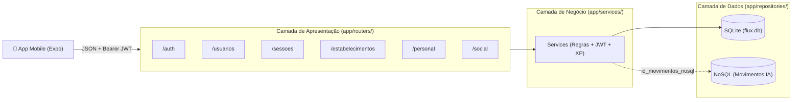

# Mapa de Endpoints da API - Projeto FLUX

Este documento descreve todos os endpoints REST da API do **FLUX** (FastAPI + SQLite), organizados por domínio e seguindo os princípios **SOLID** (`routers` -> `services` -> `repositories` -> `models`).

---

## Arquitetura da Camada de Apresentação

---

## 1. Autenticação (`/auth`)
Arquivo: `Backend/app/routers/auth_router.py`

| Método | Rota | Autenticação | Descrição |
| :---: | :--- | :---: | :--- |
| `POST` | `/auth/login` | Público | Login para o App Mobile (`identificador` + `senha`). Retorna JWT + dados do usuário. |
| `POST` | `/auth/token` | Público | Login OAuth2 Form compatível com o botão **Authorize** do Swagger (`/docs`). |
| `GET` | `/auth/me` | 🔒 JWT | Retorna os dados do perfil do usuário autenticado pelo token. |

---

## 2. Usuários e Perfil (`/usuarios`)
Arquivo: `Backend/app/routers/usuario_router.py`

| Método | Rota | Autenticação | Descrição |
| :---: | :--- | :---: | :--- |
| `POST` | `/usuarios/` | Público | Cadastra um novo usuário com senha criptografada em Argon2id. |
| `GET` | `/usuarios/buscar?q={termo}` | 🔒 JWT | Pesquisa usuários por nome ou `@username`. |
| `PATCH` | `/usuarios/me` | 🔒 JWT | Atualiza o perfil do usuário logado (`nome`, `bio`, `foto_perfil_url`, `privado`). |
| `GET` | `/usuarios/{id_usuario}` | 🔒 JWT | Busca os dados públicos/perfil de um usuário pelo ID. |

---

## 3. Sessões de Treino e Circuitos FLUX (`/sessoes`)
Arquivo: `Backend/app/routers/sessao_router.py`

| Método | Rota | Autenticação | Descrição |
| :---: | :--- | :---: | :--- |
| `POST` | `/sessoes/` | 🔒 JWT | Inicia uma sessão de treino (`tenis` ou `musculacao`). |
| `POST` | `/sessoes/sincronizar` | 🔒 JWT | Sincroniza em lote uma sessão inteira (com circuitos e movimentos da IA) gravada offline no celular. |
| `PATCH` | `/sessoes/{id_sessao}/finalizar` | 🔒 JWT | Finaliza uma sessão preenchendo `data_fim`. |
| `POST` | `/sessoes/{id_sessao}/circuitos` | 🔒 JWT | Registra um circuito/rodada no SQLite, salva os movimentos no TinyDB (`id_movimentos_nosql`) e atualiza XP e Nível do usuário. |
| `GET` | `/sessoes/circuitos/{id_circuito}/movimentos` | 🔒 JWT | Consulta no banco NoSQL (TinyDB) a lista de movimentos, velocidade e precisão média da rodada. |
| `GET` | `/sessoes/usuario/{id_usuario}` | 🔒 JWT | Lista todas as sessões e circuitos de um usuário. |
| `GET` | `/sessoes/{id_sessao}` | 🔒 JWT | Retorna os detalhes de uma sessão específica com seus circuitos. |

---

## 4. Estabelecimentos e Favoritos (`/estabelecimentos`)
Arquivo: `Backend/app/routers/estabelecimento_router.py`

| Método | Rota | Autenticação | Descrição |
| :---: | :--- | :---: | :--- |
| `POST` | `/estabelecimentos/` | 🔒 JWT | Cadastra uma arena/academia parceira. |
| `GET` | `/estabelecimentos/` | 🔒 JWT | Lista estabelecimentos parceiros ativos (filtro opcional `?cidade=`). |
| `GET` | `/estabelecimentos/meus-favoritos` | 🔒 JWT | Lista os estabelecimentos favoritados pelo usuário logado. |
| `POST` | `/estabelecimentos/{id_estabelecimento}/favoritar` | 🔒 JWT | Adiciona ou remove (toggle) o estabelecimento dos favoritos do usuário logado. |

---

## 5. Personal Trainer e Clientes (`/personal`)
Arquivo: `Backend/app/routers/personal_router.py`

| Método | Rota | Autenticação | Descrição |
| :---: | :--- | :---: | :--- |
| `POST` | `/personal/clientes` | 🔒 JWT | Vincula um aluno (`id_aluno`) à lista de clientes do Personal logado. |
| `GET` | `/personal/clientes` | 🔒 JWT | Lista os clientes/alunos vinculados ao Personal logado. |
| `PATCH` | `/personal/clientes/{id_cliente}` | 🔒 JWT | Atualiza observações ou status (`ativo` / `inativo`) do vínculo com o aluno. |
| `GET` | `/personal/clientes/{id_cliente}/sessoes` | 🔒 JWT | Lista o histórico de sessões de treino do aluno para acompanhamento no dashboard. |

---

## 6. Rede Social: Seguidores e Feed (`/social`)
Arquivo: `Backend/app/routers/social_router.py`

| Método | Rota | Autenticação | Descrição |
| :---: | :--- | :---: | :--- |
| `POST` | `/social/seguir/{id_usuario}` | 🔒 JWT | Segue ou deixa de seguir (toggle) um usuário. |
| `GET` | `/social/seguidores/{id_usuario}` | 🔒 JWT | Retorna a lista de seguidores e de quem o usuário segue. |
| `POST` | `/social/postagens` | 🔒 JWT | Publica uma postagem no feed (opcionalmente vinculada a uma `id_sessao`). |
| `GET` | `/social/feed` | 🔒 JWT | Retorna o feed de postagens (dos usuários seguidos e do próprio usuário). |
| `POST` | `/social/postagens/{id_postagem}/curtir` | 🔒 JWT | Curte ou remove a curtida (toggle) de uma postagem. |
| `POST` | `/social/postagens/{id_postagem}/comentarios` | 🔒 JWT | Adiciona um comentário em uma postagem. |

---

## 7. Modelos de IA: Atualização OTA e MLOps (`/modelos-ia`)
Arquivo: `Backend/app/routers/ia_router.py`

| Método | Rota | Autenticação | Descrição |
| :---: | :--- | :---: | :--- |
| `POST` | `/modelos-ia/upload` | 🔒 JWT | Upload de uma nova versão treinada do modelo de IA (`.tflite`, `.onnx`, `.json`) pelo ambiente Desktop. |
| `GET` | `/modelos-ia/` | 🔒 JWT | Lista todas as versões de modelos de IA cadastradas (histórico de acurácia e versões). |
| `GET` | `/modelos-ia/mais-recente?modalidade=tenis` | Público | Consultado pelo App Mobile para saber qual é a versão ativa atual do modelo e decidir se precisa baixar atualização. |
| `GET` | `/modelos-ia/{id_modelo}/download` | Público | Faz o download do arquivo do modelo de IA para o celular salvar localmente e rodar offline. |
| `PATCH` | `/modelos-ia/{id_modelo}/ativar` | 🔒 JWT | Define qual versão do modelo está ativa para distribuição OTA (permite rollback rápido). |
| `GET` | `/modelos-ia/telemetria` | 🔒 JWT | Exporta todos os movimentos salvos no TinyDB para a equipe retreinar o modelo no Desktop. |

